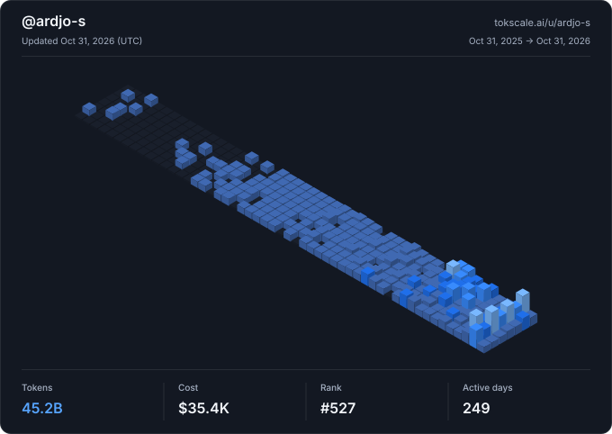

# I build my ideas (and try to have fun in the process).

<a href="https://github.com/sponsors/ardjo-s"><picture><source media="(prefers-color-scheme: dark)" srcset="https://www.shieldcn.dev/badge/Sponsor-ardjo-1DB954.svg?logo=githubsponsors&amp;logoColor=white&amp;variant=branded&amp;size=sm&amp;mode=dark&amp;font=geist"></picture></a> <a href="https://x.com/rdjooo"><picture><source media="(prefers-color-scheme: dark)" srcset="https://www.shieldcn.dev/x/follow/rdjooo.svg?variant=branded&amp;size=sm&amp;mode=dark&amp;font=geist"></picture></a> <a href="https://matrix.to/#/@ardjo:matrix.org"><picture><source media="(prefers-color-scheme: dark)" srcset="https://www.shieldcn.dev/badge/-link%20%40ardjo-000000.svg?logo=matrix&logoColor=white&variant=branded&size=sm&mode=dark&font=geist&labelColor=000000"></picture></a> <a href="https://www.linkedin.com/in/ardjo"><picture><source media="(prefers-color-scheme: dark)" srcset="https://www.shieldcn.dev/badge/Connect-ardjo-0A66C2.svg?logo=data%3Aimage%2Fsvg%2Bxml%3Bbase64%2CPHN2ZyByb2xlPSJpbWciIHZpZXdCb3g9IjAgMCAyNCAyNCIgeG1sbnM9Imh0dHA6Ly93d3cudzMub3JnLzIwMDAvc3ZnIj48dGl0bGU%2BTGlua2VkSW48L3RpdGxlPjxwYXRoIGQ9Ik0yMC40NDcgMjAuNDUyaC0zLjU1NHYtNS41NjljMC0xLjMyOC0uMDI3LTMuMDM3LTEuODUyLTMuMDM3LTEuODUzIDAtMi4xMzYgMS40NDUtMi4xMzYgMi45Mzl2NS42NjdIOS4zNTFWOWgzLjQxNHYxLjU2MWguMDQ2Yy40NzctLjkgMS42MzctMS44NSAzLjM3LTEuODUgMy42MDEgMCA0LjI2NyAyLjM3IDQuMjY3IDUuNDU1djYuMjg2ek01LjMzNyA3LjQzM2MtMS4xNDQgMC0yLjA2My0uOTI2LTIuMDYzLTIuMDY1IDAtMS4xMzguOTItMi4wNjMgMi4wNjMtMi4wNjMgMS4xNCAwIDIuMDY0LjkyNSAyLjA2NCAyLjA2MyAwIDEuMTM5LS45MjUgMi4wNjUtMi4wNjQgMi4wNjV6bTEuNzgyIDEzLjAxOUgzLjU1NVY5aDMuNTY0djExLjQ1MnpNMjIuMjI1IDBIMS43NzFDLjc5MiAwIDAgLjc3NCAwIDEuNzI5djIwLjU0MkMwIDIzLjIyNy43OTIgMjQgMS43NzEgMjRoMjAuNDUxQzIzLjIgMjQgMjQgMjMuMjI3IDI0IDIyLjI3MVYxLjcyOUMyNCAuNzc0IDIzLjIgMCAyMi4yMjIgMGguMDAzeiIvPjwvc3ZnPg%3D%3D&amp;variant=branded&amp;size=sm&amp;mode=dark&amp;font=geist"></picture></a>

<!-- tokscale-embed-start -->
<a href="https://tokscale.ai/u/ardjo-s">
  <picture>
    <source
      media="(prefers-color-scheme: light)"
      srcset="assets/tokscale/light.svg"
    />
    <source
      media="(prefers-color-scheme: dark)"
      srcset="assets/tokscale/dark.svg"
    />
    
  </picture>
</a>
<!-- tokscale-embed-end -->

<!-- starred-repos-start -->
## ⭐ Starred Repos

<a href="https://github.com/ardjo-s?tab=stars"><picture><source media="(prefers-color-scheme: dark)" srcset="https://www.shieldcn.dev/badge/All-stars-24292F.svg?variant=branded&amp;size=sm&amp;mode=dark"></picture></a>

1,315 public repositories · 26 categories · [Browse the catalog](docs/stars/README.md)

### 🤖 AI Coding Agents

AI agents whose primary job is building and maintaining software. 

<a href="docs/stars/ai-coding-agents.md"><picture><source media="(prefers-color-scheme: dark)" srcset="https://www.shieldcn.dev/badge/Summary-24292F.svg?variant=outline&amp;size=sm&amp;color=ffffff&amp;labelTextColor=ffffff&amp;mode=dark"></picture></a> <a href="docs/stars/ai-coding-agents.md#stars"><picture><source media="(prefers-color-scheme: dark)" srcset="https://www.shieldcn.dev/badge/Open-24292F.svg?variant=branded&amp;size=sm&amp;labelTextColor=ffffff&amp;mode=dark"></picture></a>

### 🕸 AI Assistants, Frameworks & Orchestration

General-purpose AI assistants, agent frameworks and orchestration platforms. 

<a href="docs/stars/ai-assistants-frameworks-orchestration.md"><picture><source media="(prefers-color-scheme: dark)" srcset="https://www.shieldcn.dev/badge/Summary-24292F.svg?variant=outline&amp;size=sm&amp;color=ffffff&amp;labelTextColor=ffffff&amp;mode=dark"></picture></a> <a href="docs/stars/ai-assistants-frameworks-orchestration.md#stars"><picture><source media="(prefers-color-scheme: dark)" srcset="https://www.shieldcn.dev/badge/Open-24292F.svg?variant=branded&amp;size=sm&amp;labelTextColor=ffffff&amp;mode=dark"></picture></a>

### 🧰 Agent Methods, Skills & Configuration

Reusable agent methods, instructions, skills, prompts and configuration. 

<a href="docs/stars/agent-methods-skills-configuration.md"><picture><source media="(prefers-color-scheme: dark)" srcset="https://www.shieldcn.dev/badge/Summary-24292F.svg?variant=outline&amp;size=sm&amp;color=ffffff&amp;labelTextColor=ffffff&amp;mode=dark"></picture></a> <a href="docs/stars/agent-methods-skills-configuration.md#stars"><picture><source media="(prefers-color-scheme: dark)" srcset="https://www.shieldcn.dev/badge/Open-24292F.svg?variant=branded&amp;size=sm&amp;labelTextColor=ffffff&amp;mode=dark"></picture></a>

### 🔌 Agent Tools & Environments

Agent tools, MCP interfaces, sandboxes and computer-use environments. 

<a href="docs/stars/agent-tools-environments.md"><picture><source media="(prefers-color-scheme: dark)" srcset="https://www.shieldcn.dev/badge/Summary-24292F.svg?variant=outline&amp;size=sm&amp;color=ffffff&amp;labelTextColor=ffffff&amp;mode=dark"></picture></a> <a href="docs/stars/agent-tools-environments.md#stars"><picture><source media="(prefers-color-scheme: dark)" srcset="https://www.shieldcn.dev/badge/Open-24292F.svg?variant=branded&amp;size=sm&amp;labelTextColor=ffffff&amp;mode=dark"></picture></a>

### 💭 AI Memory, Context & RAG

Memory, context management, semantic retrieval and RAG for AI systems. 

<a href="docs/stars/ai-memory-context-rag.md"><picture><source media="(prefers-color-scheme: dark)" srcset="https://www.shieldcn.dev/badge/Summary-24292F.svg?variant=outline&amp;size=sm&amp;color=ffffff&amp;labelTextColor=ffffff&amp;mode=dark"></picture></a> <a href="docs/stars/ai-memory-context-rag.md#stars"><picture><source media="(prefers-color-scheme: dark)" srcset="https://www.shieldcn.dev/badge/Open-24292F.svg?variant=branded&amp;size=sm&amp;labelTextColor=ffffff&amp;mode=dark"></picture></a>

### 🧠 AI Models & Training

Model architectures, machine learning, datasets, fine-tuning and training. 

<a href="docs/stars/ai-models-training.md"><picture><source media="(prefers-color-scheme: dark)" srcset="https://www.shieldcn.dev/badge/Summary-24292F.svg?variant=outline&amp;size=sm&amp;color=ffffff&amp;labelTextColor=ffffff&amp;mode=dark"></picture></a> <a href="docs/stars/ai-models-training.md#stars"><picture><source media="(prefers-color-scheme: dark)" srcset="https://www.shieldcn.dev/badge/Open-24292F.svg?variant=branded&amp;size=sm&amp;labelTextColor=ffffff&amp;mode=dark"></picture></a>

### ⚡ AI Inference & Gateways

Inference runtimes, model servers, API gateways and request routing. 

<a href="docs/stars/ai-inference-gateways.md"><picture><source media="(prefers-color-scheme: dark)" srcset="https://www.shieldcn.dev/badge/Summary-24292F.svg?variant=outline&amp;size=sm&amp;color=ffffff&amp;labelTextColor=ffffff&amp;mode=dark"></picture></a> <a href="docs/stars/ai-inference-gateways.md#stars"><picture><source media="(prefers-color-scheme: dark)" srcset="https://www.shieldcn.dev/badge/Open-24292F.svg?variant=branded&amp;size=sm&amp;labelTextColor=ffffff&amp;mode=dark"></picture></a>

### 📏 AI Evaluation & Observability

AI evaluations, traces, diagnostics, token usage, costs and quotas. 

<a href="docs/stars/ai-evaluation-observability.md"><picture><source media="(prefers-color-scheme: dark)" srcset="https://www.shieldcn.dev/badge/Summary-24292F.svg?variant=outline&amp;size=sm&amp;color=ffffff&amp;labelTextColor=ffffff&amp;mode=dark"></picture></a> <a href="docs/stars/ai-evaluation-observability.md#stars"><picture><source media="(prefers-color-scheme: dark)" srcset="https://www.shieldcn.dev/badge/Open-24292F.svg?variant=branded&amp;size=sm&amp;labelTextColor=ffffff&amp;mode=dark"></picture></a>

### 🎙️ Voice, Audio & Music

Speech, dictation, transcription, audio processing and music. 

<a href="docs/stars/voice-audio-music.md"><picture><source media="(prefers-color-scheme: dark)" srcset="https://www.shieldcn.dev/badge/Summary-24292F.svg?variant=outline&amp;size=sm&amp;color=ffffff&amp;labelTextColor=ffffff&amp;mode=dark"></picture></a> <a href="docs/stars/voice-audio-music.md#stars"><picture><source media="(prefers-color-scheme: dark)" srcset="https://www.shieldcn.dev/badge/Open-24292F.svg?variant=branded&amp;size=sm&amp;labelTextColor=ffffff&amp;mode=dark"></picture></a>

### 🎬 Image, Video & Presentations

Image and video creation, capture, editing, animation and presentations. 

<a href="docs/stars/image-video-presentations.md"><picture><source media="(prefers-color-scheme: dark)" srcset="https://www.shieldcn.dev/badge/Summary-24292F.svg?variant=outline&amp;size=sm&amp;color=ffffff&amp;labelTextColor=ffffff&amp;mode=dark"></picture></a> <a href="docs/stars/image-video-presentations.md#stars"><picture><source media="(prefers-color-scheme: dark)" srcset="https://www.shieldcn.dev/badge/Open-24292F.svg?variant=branded&amp;size=sm&amp;labelTextColor=ffffff&amp;mode=dark"></picture></a>

### 🎨 UI & Product Design

UI components, design systems, typography, prototyping and product design. 

<a href="docs/stars/ui-product-design.md"><picture><source media="(prefers-color-scheme: dark)" srcset="https://www.shieldcn.dev/badge/Summary-24292F.svg?variant=outline&amp;size=sm&amp;color=ffffff&amp;labelTextColor=ffffff&amp;mode=dark"></picture></a> <a href="docs/stars/ui-product-design.md#stars"><picture><source media="(prefers-color-scheme: dark)" srcset="https://www.shieldcn.dev/badge/Open-24292F.svg?variant=branded&amp;size=sm&amp;labelTextColor=ffffff&amp;mode=dark"></picture></a>

### 🧱 App, Web & Mobile Development

Web, backend, native and mobile frameworks for building applications. 

<a href="docs/stars/app-web-mobile-development.md"><picture><source media="(prefers-color-scheme: dark)" srcset="https://www.shieldcn.dev/badge/Summary-24292F.svg?variant=outline&amp;size=sm&amp;color=ffffff&amp;labelTextColor=ffffff&amp;mode=dark"></picture></a> <a href="docs/stars/app-web-mobile-development.md#stars"><picture><source media="(prefers-color-scheme: dark)" srcset="https://www.shieldcn.dev/badge/Open-24292F.svg?variant=branded&amp;size=sm&amp;labelTextColor=ffffff&amp;mode=dark"></picture></a>

### ⌨️ Developer Tools & Languages

Languages, editors, terminals, Git tools and general developer resources. 

<a href="docs/stars/developer-tools-languages.md"><picture><source media="(prefers-color-scheme: dark)" srcset="https://www.shieldcn.dev/badge/Summary-24292F.svg?variant=outline&amp;size=sm&amp;color=ffffff&amp;labelTextColor=ffffff&amp;mode=dark"></picture></a> <a href="docs/stars/developer-tools-languages.md#stars"><picture><source media="(prefers-color-scheme: dark)" srcset="https://www.shieldcn.dev/badge/Open-24292F.svg?variant=branded&amp;size=sm&amp;labelTextColor=ffffff&amp;mode=dark"></picture></a>

### ✅ Testing, Debugging & Code Quality

Software testing, debugging, code review and technical quality checks. 

<a href="docs/stars/testing-debugging-code-quality.md"><picture><source media="(prefers-color-scheme: dark)" srcset="https://www.shieldcn.dev/badge/Summary-24292F.svg?variant=outline&amp;size=sm&amp;color=ffffff&amp;labelTextColor=ffffff&amp;mode=dark"></picture></a> <a href="docs/stars/testing-debugging-code-quality.md#stars"><picture><source media="(prefers-color-scheme: dark)" srcset="https://www.shieldcn.dev/badge/Open-24292F.svg?variant=branded&amp;size=sm&amp;labelTextColor=ffffff&amp;mode=dark"></picture></a>

### 🚀 Systems, Cloud & DevOps

Operating systems, networking, deployment, cloud infrastructure and DevOps. 

<a href="docs/stars/systems-cloud-devops.md"><picture><source media="(prefers-color-scheme: dark)" srcset="https://www.shieldcn.dev/badge/Summary-24292F.svg?variant=outline&amp;size=sm&amp;color=ffffff&amp;labelTextColor=ffffff&amp;mode=dark"></picture></a> <a href="docs/stars/systems-cloud-devops.md#stars"><picture><source media="(prefers-color-scheme: dark)" srcset="https://www.shieldcn.dev/badge/Open-24292F.svg?variant=branded&amp;size=sm&amp;labelTextColor=ffffff&amp;mode=dark"></picture></a>

### 🗄 Data, Databases & GIS

Databases, data pipelines, analytics, visualization and geospatial tools. 

<a href="docs/stars/data-databases-gis.md"><picture><source media="(prefers-color-scheme: dark)" srcset="https://www.shieldcn.dev/badge/Summary-24292F.svg?variant=outline&amp;size=sm&amp;color=ffffff&amp;labelTextColor=ffffff&amp;mode=dark"></picture></a> <a href="docs/stars/data-databases-gis.md#stars"><picture><source media="(prefers-color-scheme: dark)" srcset="https://www.shieldcn.dev/badge/Open-24292F.svg?variant=branded&amp;size=sm&amp;labelTextColor=ffffff&amp;mode=dark"></picture></a>

### ⚙️ Web & Document Automation

Web extraction, scraping, OCR, document conversion and automation. 

<a href="docs/stars/web-document-automation.md"><picture><source media="(prefers-color-scheme: dark)" srcset="https://www.shieldcn.dev/badge/Summary-24292F.svg?variant=outline&amp;size=sm&amp;color=ffffff&amp;labelTextColor=ffffff&amp;mode=dark"></picture></a> <a href="docs/stars/web-document-automation.md#stars"><picture><source media="(prefers-color-scheme: dark)" srcset="https://www.shieldcn.dev/badge/Open-24292F.svg?variant=branded&amp;size=sm&amp;labelTextColor=ffffff&amp;mode=dark"></picture></a>

### 🔐 Security, Privacy & Identity

Authentication, identity, secrets, privacy and security assessment. 

<a href="docs/stars/security-privacy-identity.md"><picture><source media="(prefers-color-scheme: dark)" srcset="https://www.shieldcn.dev/badge/Summary-24292F.svg?variant=outline&amp;size=sm&amp;color=ffffff&amp;labelTextColor=ffffff&amp;mode=dark"></picture></a> <a href="docs/stars/security-privacy-identity.md#stars"><picture><source media="(prefers-color-scheme: dark)" srcset="https://www.shieldcn.dev/badge/Open-24292F.svg?variant=branded&amp;size=sm&amp;labelTextColor=ffffff&amp;mode=dark"></picture></a>

### 🗂 Knowledge & Productivity

Notes, writing, reading, tasks, calendars and collaboration. 

<a href="docs/stars/knowledge-productivity.md"><picture><source media="(prefers-color-scheme: dark)" srcset="https://www.shieldcn.dev/badge/Summary-24292F.svg?variant=outline&amp;size=sm&amp;color=ffffff&amp;labelTextColor=ffffff&amp;mode=dark"></picture></a> <a href="docs/stars/knowledge-productivity.md#stars"><picture><source media="(prefers-color-scheme: dark)" srcset="https://www.shieldcn.dev/badge/Open-24292F.svg?variant=branded&amp;size=sm&amp;labelTextColor=ffffff&amp;mode=dark"></picture></a>

### 📈 Marketing, Sales & Careers

Marketing, SEO, sales, customer relationships, recruiting and careers. 

<a href="docs/stars/marketing-sales-careers.md"><picture><source media="(prefers-color-scheme: dark)" srcset="https://www.shieldcn.dev/badge/Summary-24292F.svg?variant=outline&amp;size=sm&amp;color=ffffff&amp;labelTextColor=ffffff&amp;mode=dark"></picture></a> <a href="docs/stars/marketing-sales-careers.md#stars"><picture><source media="(prefers-color-scheme: dark)" srcset="https://www.shieldcn.dev/badge/Open-24292F.svg?variant=branded&amp;size=sm&amp;labelTextColor=ffffff&amp;mode=dark"></picture></a>

### 💼 Finance, Legal & Business Operations

Finance, payments, legal work and business operations. 

<a href="docs/stars/finance-legal-business-operations.md"><picture><source media="(prefers-color-scheme: dark)" srcset="https://www.shieldcn.dev/badge/Summary-24292F.svg?variant=outline&amp;size=sm&amp;color=ffffff&amp;labelTextColor=ffffff&amp;mode=dark"></picture></a> <a href="docs/stars/finance-legal-business-operations.md#stars"><picture><source media="(prefers-color-scheme: dark)" srcset="https://www.shieldcn.dev/badge/Open-24292F.svg?variant=branded&amp;size=sm&amp;labelTextColor=ffffff&amp;mode=dark"></picture></a>

### 🔬 Research, Science & Health

Research, source discovery, science, health and fitness. 

<a href="docs/stars/research-science-health.md"><picture><source media="(prefers-color-scheme: dark)" srcset="https://www.shieldcn.dev/badge/Summary-24292F.svg?variant=outline&amp;size=sm&amp;color=ffffff&amp;labelTextColor=ffffff&amp;mode=dark"></picture></a> <a href="docs/stars/research-science-health.md#stars"><picture><source media="(prefers-color-scheme: dark)" srcset="https://www.shieldcn.dev/badge/Open-24292F.svg?variant=branded&amp;size=sm&amp;labelTextColor=ffffff&amp;mode=dark"></picture></a>

### 🎮 Games & 3D

Games, rendering, geometry, avatars and interactive 3D worlds. 

<a href="docs/stars/games-3d.md"><picture><source media="(prefers-color-scheme: dark)" srcset="https://www.shieldcn.dev/badge/Summary-24292F.svg?variant=outline&amp;size=sm&amp;color=ffffff&amp;labelTextColor=ffffff&amp;mode=dark"></picture></a> <a href="docs/stars/games-3d.md#stars"><picture><source media="(prefers-color-scheme: dark)" srcset="https://www.shieldcn.dev/badge/Open-24292F.svg?variant=branded&amp;size=sm&amp;labelTextColor=ffffff&amp;mode=dark"></picture></a>

### 🦾 Robotics, Hardware & CAD

Robotics, electronics, embedded systems, CAD and physical fabrication. 

<a href="docs/stars/robotics-hardware-cad.md"><picture><source media="(prefers-color-scheme: dark)" srcset="https://www.shieldcn.dev/badge/Summary-24292F.svg?variant=outline&amp;size=sm&amp;color=ffffff&amp;labelTextColor=ffffff&amp;mode=dark"></picture></a> <a href="docs/stars/robotics-hardware-cad.md#stars"><picture><source media="(prefers-color-scheme: dark)" srcset="https://www.shieldcn.dev/badge/Open-24292F.svg?variant=branded&amp;size=sm&amp;labelTextColor=ffffff&amp;mode=dark"></picture></a>

### 💻 Browsers, Desktop & Device Utilities

Browsers, desktop utilities, file transfers and device tools. 

<a href="docs/stars/browsers-desktop-device-utilities.md"><picture><source media="(prefers-color-scheme: dark)" srcset="https://www.shieldcn.dev/badge/Summary-24292F.svg?variant=outline&amp;size=sm&amp;color=ffffff&amp;labelTextColor=ffffff&amp;mode=dark"></picture></a> <a href="docs/stars/browsers-desktop-device-utilities.md#stars"><picture><source media="(prefers-color-scheme: dark)" srcset="https://www.shieldcn.dev/badge/Open-24292F.svg?variant=branded&amp;size=sm&amp;labelTextColor=ffffff&amp;mode=dark"></picture></a>

### 📚 AI Engineering & Learning

AI application SDKs, structured outputs, examples and engineering courses. 

<a href="docs/stars/ai-engineering-learning.md"><picture><source media="(prefers-color-scheme: dark)" srcset="https://www.shieldcn.dev/badge/Summary-24292F.svg?variant=outline&amp;size=sm&amp;color=ffffff&amp;labelTextColor=ffffff&amp;mode=dark"></picture></a> <a href="docs/stars/ai-engineering-learning.md#stars"><picture><source media="(prefers-color-scheme: dark)" srcset="https://www.shieldcn.dev/badge/Open-24292F.svg?variant=branded&amp;size=sm&amp;labelTextColor=ffffff&amp;mode=dark"></picture></a>

<!-- starred-repos-end -->
